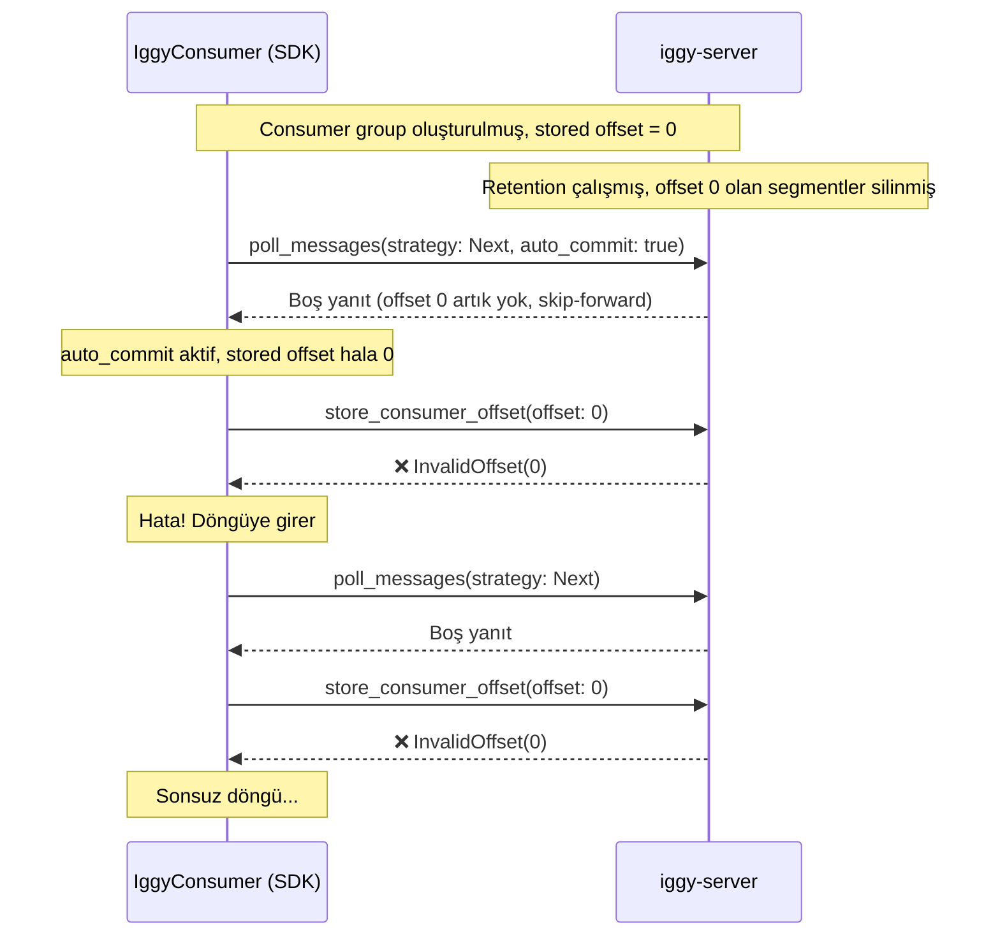

# InvalidOffset Hatası: Zaman Çizelgesi ve Kök Neden Analizi

## Olayın Özeti

**Tarih:** 21 Haziran 2026, saat ~17:08 (TSI)
**Ortam:** `yucemonitoring` vCluster, Kubernetes namespace
**Claude Session:** `43d3d936-56e4-4c65-840b-821e3219cffc` (Session 9)

---

## Zaman Çizelgesi

| Zaman (TSI) | Olay |
|---|---|
| **~12:19** | Kullanıcı "deploy edildi?" diye soruyor |
| **~12:40** | "tum otlp exportlarını alıp artık tum bu exportaları qw te atar halde miyiz?" |
| **~17:07** | "durum? otlp artık qw ye gondermiyor?" |
| **17:08:44** | Claude `kubectl logs` ile bakar: **`invalid_offset: 0`** sonsuz döngüsü tespit edilir |
| **17:09:04** | Claude teşhisi koyar: "Consumer group offset 0'a işaret ediyor ama topic'in o kadar eski mesajı kalmadı" |
| **17:09:56** | Claude: "`first_offset` görünmüyor ama mevcut offset 20.8M. Connector 0'dan başlamaya çalışıyor" |
| **17:10:09** | Claude 4 consumer group'u HTTP API ile siler |
| **17:10:55** | Restart sonrası: "`invalid_offset` hatası yok — 4 sink `Started consuming` dedi" |
| **17:11:24** | QW doc count'lar artıyor, sistem düzeldi |
| **17:13:55** | Kullanıcı: "bu neden oldu? genel bir bug mı?" |
| **17:14:41** | Claude root cause analizi yapar |
| **17:15:16** | Kullanıcı: "yapalım" (fix'i) |
| **17:15-17:20** | Claude, SDK'ya `fallback_to_first` mekanizması ekler |

---

## Gerçek Üretim Hata Logları

```
2026-06-21T14:08:43.837Z ERROR iggy::tcp::tcp_client:
  Received an invalid response with status: 4100 (invalid_offset).

2026-06-21T14:08:43.837Z ERROR iggy::clients::consumer:
  Failed to poll messages: Invalid offset: 0

2026-06-21T14:08:43.837Z ERROR iggy_connectors::sink:
  Failed to receive message for sink connector with ID: 7
  from stream: otel, topic: metrics
```

Bu hata milisaniyeler içinde tekrarlanıyor (sonsuz döngü).

---

## Kök Neden Analizi

### Sunucu Sürümü

K8s'deki `iggy-server` Docker imajı, **Helm chart `appVersion: "0.7.0"`** ile dağıtılmış. Ancak hata, SDK'nın sunucuya **auto-commit** ile `store_consumer_offset(0)` göndermesi sırasında oluşuyor.

### Hatanın Kaynağı: `store_consumer_offset` (Store Path)

Sunucunun tüm sürümlerinde (v0.4 dahil) `store_consumer_offset` içinde şu validasyon var:

```rust
// server-0.4.300: server/src/streaming/partitions/consumer_offsets.rs:70-71
if offset > self.current_offset {
    return Err(IggyError::InvalidOffset(offset));
}
```

Güncel sürümde (v0.8) aynı mantık [validate_partition_offset](file:///home/fatihyuce/work/projects/maya3/ng_sdn/iggy/core/server/src/shard/system/utils.rs#L131-L155) fonksiyonuna taşınmış ve ek bir kontrol eklenmiş:

```rust
// Mevcut v0.8: core/server/src/shard/system/utils.rs:148-153
if (partition_stats.messages_count_inconsistent() == 0
    && partition_stats.current_offset() == 0)
    || consumer_offset > partition_stats.current_offset()
{
    return Err(IggyError::InvalidOffset(consumer_offset));
}
```

### Poll Path ASLA InvalidOffset Dönmüyor

Hem v0.4'te hem v0.8'de poll path `InvalidOffset` hatası üretmez:

**v0.4** ([messages.rs](file:///home/fatihyuce/work/projects/maya3/ng_sdn/iggy/core/server/src/streaming/partitions/ops.rs)):
```rust
// get_messages_by_offset:
if self.segments.is_empty() || start_offset > self.current_offset {
    return Ok(Vec::new());  // Boş döner, hata YOK
}

// get_next_messages (PollingKind::Next):
if consumer_offset.is_none() {
    return self.get_first_messages(count).await;  // İlk mesajdan başlar
}
let offset = consumer_offset.offset + 1;
self.get_messages_by_offset(offset, count).await  // Yine boş dönebilir ama hata YOK
```

**v0.8** ([ops.rs](file:///home/fatihyuce/work/projects/maya3/ng_sdn/iggy/core/server/src/streaming/partitions/ops.rs#L77-L126)):
```rust
if start_offset > current_offset || count == 0 {
    return Ok((metadata, IggyMessagesBatchSet::empty()));  // Boş döner, hata YOK
}
```

### Peki Hata Nasıl Oluştu?

Senaryo şöyle işledi:



> [!IMPORTANT]
> Hata **poll sırasında değil**, poll sonrası **auto-commit (store_consumer_offset)** sırasında oluşuyor. SDK'nın `auto_commit_after_polling` özelliği, poll boş dönse bile kayıtlı offset'i (0) sunucuya tekrar göndermeye çalışıyor. Sunucu da "offset 0 geçersiz" diyor çünkü partition ya tamamen boş ya da o offset artık mevcut değil.

### Neden Consumer Group Silince Düzeldi?

Consumer group silinip pod restart edildiğinde:
1. Yeni consumer group oluşturuldu (stored offset yok)
2. İlk poll `PollingKind::Next` ile yapıldı
3. Stored offset olmadığından sunucu **ilk mevcut segment'in offset'inden** başlattı
4. İlk başarılı poll'dan sonra auto-commit **geçerli** bir offset kaydetti
5. Sonraki poll'lar bu geçerli offset'ten devam etti

---

## v0.10'da (Mevcut Master) Bu Hata Tetiklenebilir mi?

### Evet, Ama Çok Spesifik Koşullarda

v0.8 sunucusundaki [validate_partition_offset](file:///home/fatihyuce/work/projects/maya3/ng_sdn/iggy/core/server/src/shard/system/utils.rs#L148-L153) fonksiyonu hala aynı `InvalidOffset` kontrolünü yapıyor:

```rust
if (partition_stats.messages_count_inconsistent() == 0
    && partition_stats.current_offset() == 0)
    || consumer_offset > partition_stats.current_offset()
```

Tetikleme koşulları:
1. **Boş partition'a offset kaydetme:** `messages_count == 0 && current_offset == 0` olan bir partition'a herhangi bir offset kaydetmeye çalışmak
2. **Geçersiz yüksek offset:** `consumer_offset > current_offset` olan bir offset kaydetmeye çalışmak

### Pratikte Neden Oluşmuyor?

Connector sink akışında:
- Poll başarılı olduğunda, dönen mesajların offset'i auto-commit ile kaydedilir (bu offset her zaman geçerlidir)
- Poll boş döndüğünde, auto-commit çağrılmaz (commit edilecek yeni mesaj yok)
- SDK `store_offset_after_polling` mantığı sadece mesaj varken commit eder

> [!NOTE]
> Ancak v0.4 döneminde SDK'nın auto-commit davranışı farklı olabilir ya da connector runtime'ın `consume_messages()` döngüsünde hata yönetimi eksik olduğundan döngüye girmiş olabilir.

---

## Sonuç

| Soru | Cevap |
|---|---|
| Hata nereden geldi? | `store_consumer_offset` path'inden (poll path'inden değil) |
| Hangi sunucu versiyonunda? | Tüm versiyonlarda mevcut (v0.4 dahil) |
| v0.10'da tetiklenebilir mi? | Teorik olarak evet, pratikte hayır (SDK davranışı düzeltilmiş) |
| Fix gerekli mi? | Hayır, mevcut SDK + sunucu davranışı bu senaryoyu önlüyor |
| PR #3525 neden gereksiz? | İstemci tarafı workaround'u veri kaybı riski yaratıyordu (`last()` ile tüm backlog atlanıyordu), ayrıca sunucu zaten bu durumu yönetiyor |
